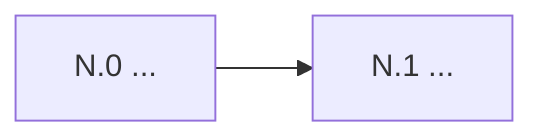

# Sprint N Implementation Plan — BrokerCRM

> **Status:** Proposed | Approved (YYYY-MM-DD)
> **Scope approved by:** founder | "agent decided" (founder delegated)
> **Duration:** ~X weeks (≈Y dev-days)
> **Companion:** `docs/sprint-N-task-list.md`

## 1. Sprint Theme
> **"<one line>"**
<2–3 sentences: why this sprint, which pilot criteria or north-star lever it moves.>

## 2. Pre-Sprint Findings
| # | Finding (docs vs code vs DB) | Severity | Fixed in |
|---|---|---|---|
| F-01 | | | |

## 3. Prioritised Scope
### 3.1 In scope
| Priority | Item | Source · Evidence | Score | Effort | Why now |
|---|---|---|---|---|---|

### 3.2 Deferred (again)
| Item | New target | Reason |
|---|---|---|

### 3.3 Business rules & assumptions
<Mini-specs for each in-scope item (product-discovery §5). Keep each one short.>

## 4. Slice Breakdown

| Slice | Est. (d) | Week | Depends on |
|---|---|---|---|
| **Total** | | | |

### Slice N.S — <Name>
**Goal:** <user-visible outcome> · **Flag:** <if any>
- **Migrations:** <tables/columns/indexes/functions; RLS per P-001; pgTAP file>
- **Domain** (`src/domain/<entity>/`): types · validation (Zod) · repository · service
- **Server Actions:** <name → purpose, role gate>
- **UI:** <routes, components (domain/ vs ui/), i18n keys namespace, mobile notes>
- **Tests:** <pgTAP isolation, Vitest logic, manual browser check>
- **Acceptance criteria:** AC-N.S-1 … (map to FR-/US-/PAC- IDs)
- **Risks / dependencies:** <...>

## 5. New Decisions Needed
### AD-0XX: <title> — Proposed
**Context:** · **Options:** A / B / C · **Recommendation:** · **Revisit if:**

## 6. New BRD Entries
| ID | Requirement / Story | Slice |
|---|---|---|

## 7. Budget & Cut List
<Ordered: what to drop first if behind schedule.>

## 8. Risks & Dependencies (sprint-level)
| Risk | Likelihood | Impact | Mitigation |
|---|---|---|---|

## 9. Pilot Validation Hooks
| Assumption | How we'll measure it in the pilot | Feeds sprint |
|---|---|---|
