# BrokerCRM Domain Model

The single reference for entities, relationships, lifecycles, invariants and vocabulary.
Built from `supabase/migrations/` and `src/domain/` as of the 36th migration
(`20261102000003_drop_untracked_profile_insert_policy.sql`). It describes what is **built**;
planned modules add their area when their migrations land (`SPEC.md` §3).

**Keep it current:** any migration that adds or changes a table, a status value, a
constraint or a trigger updates this file in the same change. Any new business rule adds a
row to [Invariants](#5-invariants). Code wins over this doc: if they disagree, fix the doc
or log the gap in [Known gaps](#6-known-gaps).

Contents:
1. [Context map](#1-context-map)
2. [Entity diagrams by area](#2-entity-diagrams-by-area)
3. [Lifecycles](#3-lifecycles)
4. [Screens' derived views](#4-derived-views-today-and-exceptions)
5. [Invariants](#5-invariants)
6. [Known gaps](#6-known-gaps)
7. [Glossary EN / BG](#7-glossary-en--bg)
8. [How to extend](#8-how-to-extend-this-model)

---

## 1. Context map

Each area owns its tables. New features should land in one area, or add a new one, rather
than growing one big diagram.

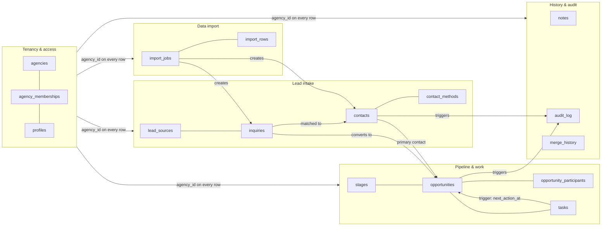

Every table except `agencies` and `profiles` carries `agency_id` and is isolated by RLS
(`current_agency_id()`). `profiles` is user-level, visible to self and colleagues
(`shares_agency_with()`).

---

## 2. Entity diagrams by area

Only keys and columns that carry business meaning are shown. `id`, `created_at`,
`updated_at` exist on every table (except: `opportunity_participants`, `merge_history`,
`import_rows` have no `updated_at`; `audit_log` uses `performed_at`).

### 2.1 Tenancy & access

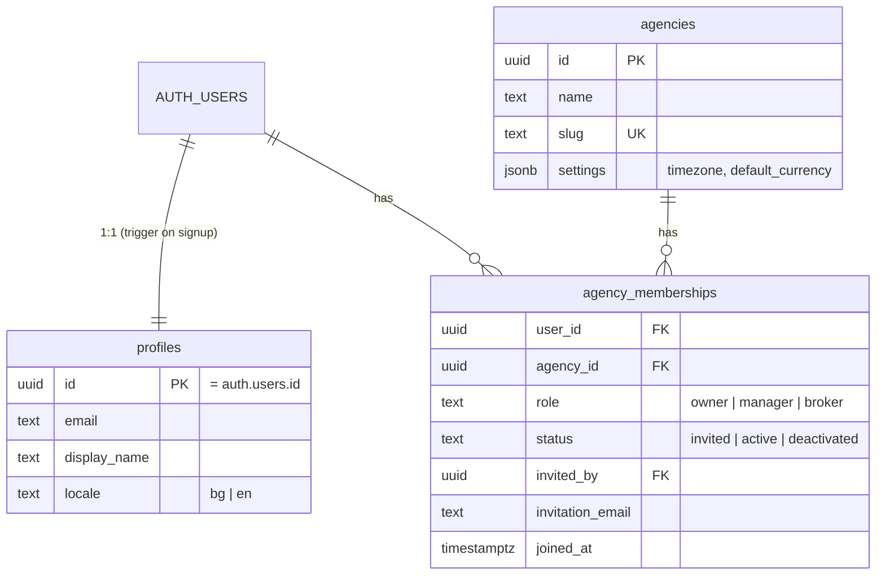

### 2.2 Lead intake

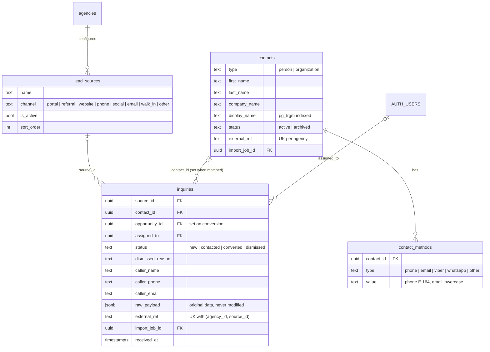

### 2.3 Pipeline & work

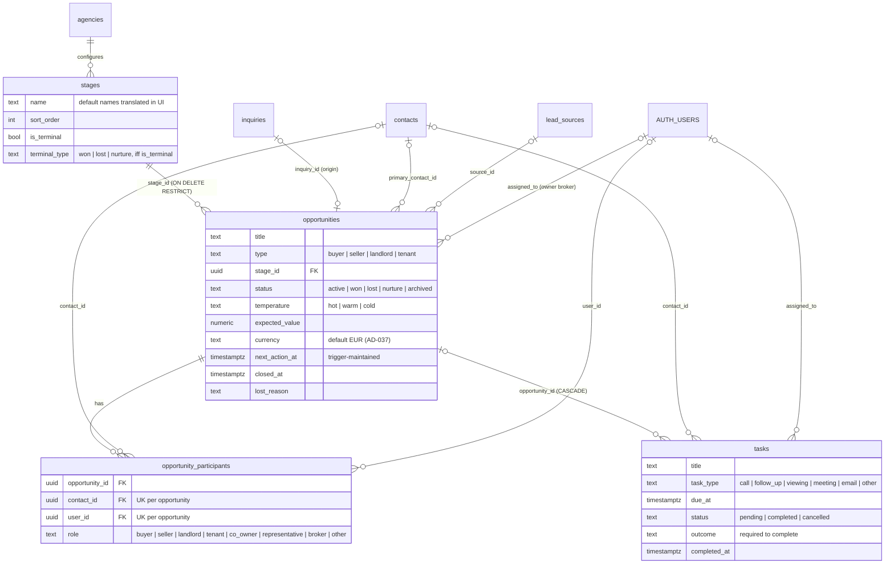

### 2.4 History & audit

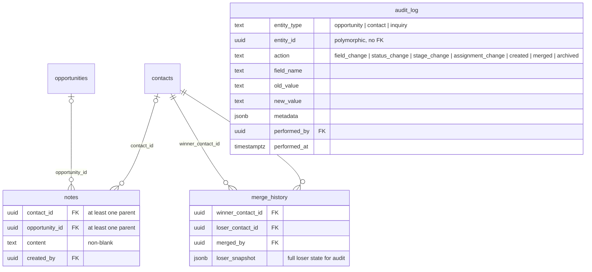

The **timeline** (`src/domain/timeline`) is not a table. It reads `notes`, `tasks`,
`audit_log` and `inquiries` in parallel and merges them in memory into the
`TimelineEntry` union.

### 2.5 Data import

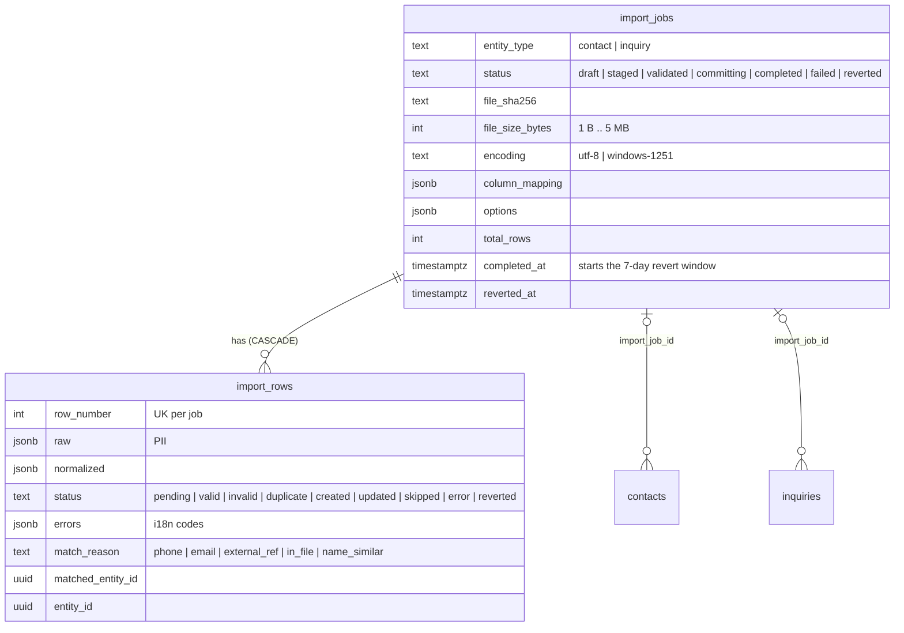

---

## 3. Lifecycles

Statuses are enforced as `CHECK` value lists. **Transitions** are enforced only where
the "Enforced by" note says so; everything else is convention in services.

### 3.1 Inquiry

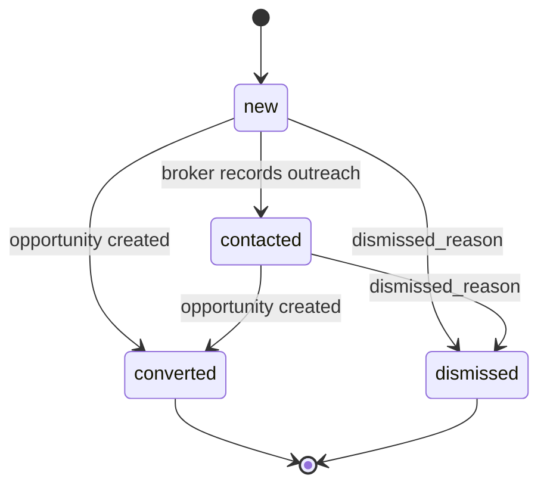

Enforced by: `InquiryService` checks `INQUIRY_STATUS_TRANSITIONS`
(`src/domain/inquiries/validation.ts`); `converted` and `dismissed` are final. The database
checks the value list only.

### 3.2 Opportunity: status and stage

An opportunity has two independent axes: `stage_id` (position in the agency's pipeline)
and `status` (lifecycle).

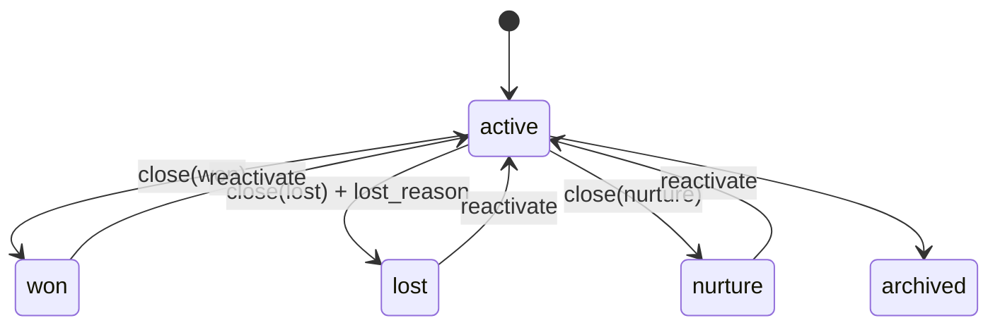

- `close()` sets `status` and `closed_at` (and `lost_reason` for lost);
  `reactivate()` sets `active` and clears both.
- Default stages (seeded per agency, BG or EN by signup locale): New → Attempting Contact
  → Qualified → Active → Viewing → Offer → Negotiation → Won | Lost | Nurture (terminal).
- An agency must keep at least one `won` and one `lost` terminal stage
  (`StageService`). A stage used by opportunities can't be deleted (service plus FK `RESTRICT`).
- See [Known gaps](#6-known-gaps): stage and status are not synchronised.

### 3.3 Task

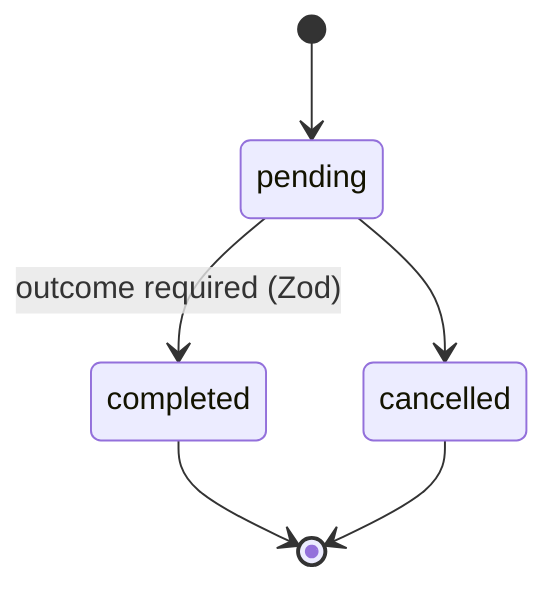

`completeWithNext` optionally creates the next task (inherits opportunity and assignee)
and optionally moves the opportunity's stage. Both are optional (AD-014 soft
enforcement); the UI prompts for them. Every insert, delete, or change to `status` or
`due_at` recomputes `opportunities.next_action_at` = earliest pending `due_at` (trigger).

Only a `pending` task can be edited, rescheduled, cancelled or completed; `completed` and
`cancelled` are final (`TaskService`, `DomainError('errors.task_not_pending')`, plus a
`status = 'pending'` filter on the write, which raises the same error when someone else
changed the task first; AD-046). Cancelling keeps the optional reason in
`outcome`. Reschedule presets (+1 h, tomorrow 09:00, +2 days, next Monday 09:00) and every
`datetime-local` due date are read in the agency's timezone (presets in
`src/domain/tasks/reschedule.ts`, `parseAgencyLocal` in `src/lib/time/agency-day.ts`).

### 3.4 Membership and invitation

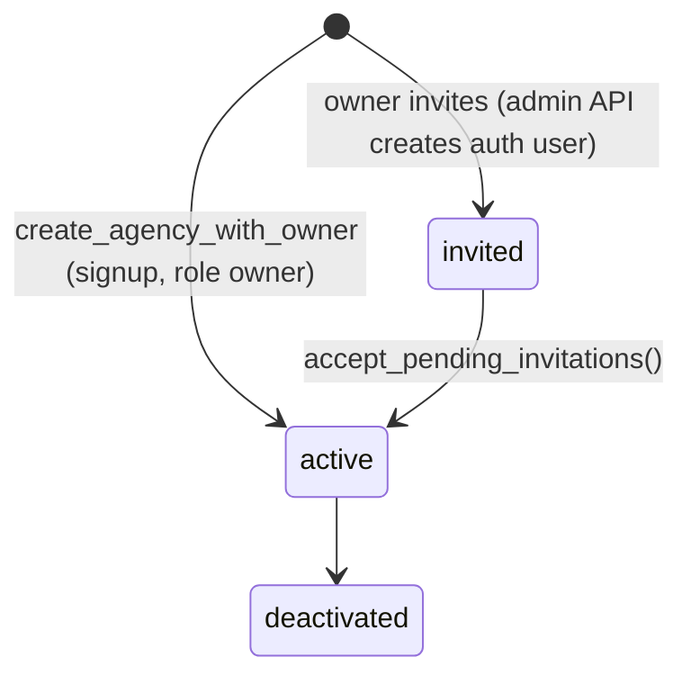

A user can have at most one `active` membership (partial unique index).
`user_id` and `agency_id` of a membership can never change (trigger).

### 3.5 Import job

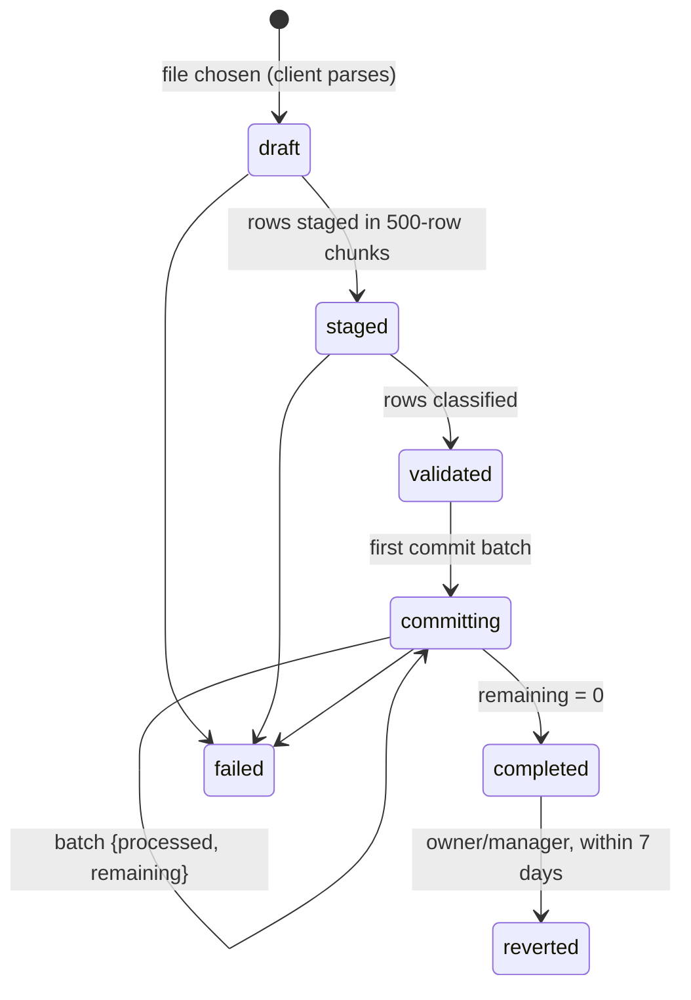

Revert is meant to delete only created records that haven't been touched since (no tasks,
notes or linked inquiries) and mark their rows `reverted`. The notes guard doesn't work yet
(see [Known gaps](#6-known-gaps)).

---

## 4. Derived views: Today and Exceptions

Not stored. Today is assembled in `src/app/(dashboard)/today/today-data.ts` from
`src/domain/tasks` and `src/domain/inquiries`; Exceptions in `src/domain/exceptions`. Both use
agency-local day boundaries (`src/lib/time/agency-day.ts`).

**Today** (`/today`): "my" work for everyone by default. Owners and managers can switch to
the whole agency with `?scope=agency`, which drops the "mine" filter (AD-044). Brokers always
see their own.

| Section | Definition |
|---|---|
| New inquiries | inquiries `status = 'new'` assigned to me |
| Overdue | my tasks `pending` with `due_at < now` |
| Due today | my tasks `pending` with `now ≤ due_at <` agency midnight |
| Upcoming | my tasks `pending` from tomorrow 00:00 to the end of day +3 (agency tz) |
| At risk | my opportunities `active` with `next_action_at` null |

The ranges are half-open and contiguous (`getTodayWindows`), so a task is in one section only.

**Exceptions** (`/exceptions`, owner/manager only):

| Section | Definition |
|---|---|
| Unassigned inquiries | `status = 'new'` and `assigned_to` null |
| Overdue tasks by broker | count of `pending` tasks with `due_at < now`, most overdue first |
| At risk | `active` opportunities with `next_action_at` null, updated within 7 days |
| Stale | same, but not updated for 7+ days |
| Workload | active opportunities and pending tasks per broker |

---

## 5. Invariants

The "Enforced by" column tells you which layer to change and test.

| # | Rule | Enforced by |
|---|---|---|
| T1 | Every tenant row has `agency_id`; users see only their agency | RLS `ENABLE` and `FORCE` + `010-rls-catalog.sql` |
| T2 | Hard delete of contacts, inquiries, opportunities, tasks, stages and lead sources only by owner/manager; contact methods, participants and notes by any member | RLS `current_user_role()` on the DELETE policies |
| T3 | One active membership per user | partial unique index `uq_one_active_membership_per_user` |
| T4 | Membership `user_id`/`agency_id` immutable | trigger `trg_membership_identity` |
| T5 | Agency + owner membership + default seeds created atomically | RPC `create_agency_with_owner` |
| T6 | Creating or editing stages and lead sources, and merging contacts, is owner/manager only (AD-045) | RLS `current_user_role()` on `stages`, `lead_sources`, `merge_history` + `requireRole()` in the actions |
| C1 | Person needs a name; organization needs `company_name` | `CHECK` on `contacts` |
| C2 | Phones E.164 (any country, BG default region, AD-041), emails lowercase | `normalizePhone()` / Zod on contact methods (inquiry callers: not yet, see Known gaps) |
| C3 | Duplicate check (phone, email, trigram name) before creating a contact | `duplicate-detection.ts` (service) |
| C4 | Merge archives the loser and snapshots it | `merge.ts` + `merge_history` |
| C5 | `external_ref` unique per agency | unique index `uq_contacts_agency_external_ref` |
| I1 | `raw_payload` is never modified | convention (not in update schema) |
| I2 | Inquiry idempotent on `(agency_id, source_id, external_ref)` | unique index `uq_inquiries_source_external_ref` |
| I3 | Inquiry status follows `new → contacted → converted / dismissed`; final states don't change | `InquiryService` + `INQUIRY_STATUS_TRANSITIONS` |
| O1 | Opportunity always has a stage | `NOT NULL` + FK `RESTRICT` |
| O2 | Lost requires `lost_reason` | Zod `closeOpportunitySchema` |
| O3 | `next_action_at` = earliest pending task due date | trigger `sync_opportunity_next_action` |
| O4 | `active` with no `next_action_at` ⇒ at risk | derived view (section 4) |
| S1 | `terminal_type` set iff `is_terminal` | `CHECK terminal_type_consistency` |
| S2 | At least one won and one lost stage per agency | `StageService` |
| K1 | Completing a task requires an outcome | Zod `completeWithNext` in `taskSchemas()` |
| K2 | Next task or stage change on completion | UI prompt only (AD-014, soft) |
| K3 | Only a pending task can be edited, rescheduled, cancelled or completed (AD-046) | `TaskService` + `status = 'pending'` filter on the write |
| P1 | Participant has a contact or a user, each at most once per opportunity | `CHECK` + unique constraints |
| N1 | A note has a contact or opportunity parent, and non-blank content | `CHECK` on `notes` |
| A1 | `audit_log` is append-only, written by triggers | no insert/update/delete policy for members; SECURITY DEFINER triggers on opportunities and contacts (imported contacts via `audit_imported_contact_created`) |
| M1 | Import file ≤ 5 MB, UTF-8 or Windows-1251 | `CHECK` on `import_jobs` |
| M2 | Import revert: owner/manager, `completed` job, within 7 days | RPC `import_revert` |

---

## 6. Known gaps

Where the built model breaks its own rules. Each is a candidate for a fix or an AD; the
module that fixes it is named where there is one. Remove a row when the fix lands.

1. **Stage and status are independent.** Closing an opportunity does not move it to a
   terminal stage, and moving it to a terminal stage (including via `completeWithNext`)
   does not change `status`. An opportunity can sit in stage "Won" with status `active`.
2. **Inquiries are not audited.** `audit_log.entity_type` allows `'inquiry'`, but no
   trigger exists on `inquiries`.
3. **Opportunity status transitions are unchecked.** `close()` and `reactivate()` don't check
   the current status (inquiries and tasks are checked: I3, K3).
4. **Inquiry callers aren't normalized.** `caller_phone` and `caller_email` are stored and
   copied to `contact_methods` on conversion as typed, and only Bulgarian mobiles parse
   (C2). → `trustworthy-loop` (AD-041).
5. **Import revert and recheck.** The revert's notes guard can't fire, and the recheck writes
   `match_reason` values (`db_recheck…`) that the `import_rows` CHECK rejects.
   → `trustworthy-loop`.
6. **Signup profile name.** Sign-up sends `full_name`, but `handle_new_user` reads
   `display_name`, so the name defaults to the email prefix. → `trustworthy-loop`.
7. **BG vocabulary is inconsistent** (see the glossary): the same term has several translations.

---

## 7. Glossary EN / BG

The BG column is the **canonical** term. Use it for new strings. Variants found in
`messages/bg.json` are listed so they can be aligned.

| English | Bulgarian (canonical) | Meaning | Variants in use |
|---|---|---|---|
| Agency | Агенция | Tenant: one brokerage | |
| Owner / Manager / Broker | Собственик / Мениджър / Брокер | Membership roles | |
| Inquiry | Запитване | Inbound lead event | |
| Lead source | Източник | Where inquiries come from | Източници на запитвания, Източници на лийдове |
| Contact | Контакт | Durable person or organization | |
| Contact method | Метод за връзка | Phone, email, Viber... | |
| Opportunity | Сделка | Commercial pursuit (AD-038) | |
| Stage | Етап | Pipeline position | |
| Pipeline | Фуния | Ordered stages | пайплайн (Фуния itself not used yet) |
| Won / Lost | Спечелена / Загубена | Terminal outcomes | Изгубена |
| Nurture | Задържана | On hold for later | Отглеждане, За подхранване |
| Task | Задача | Scheduled follow-up | |
| Outcome | Резултат | What happened on a task | |
| Next action | Следващо действие | Earliest pending task | |
| At risk | В риск | Active, no next action | |
| Overdue | Просрочена | Pending, past due | |
| Stale | Изоставена | At risk and not updated 7+ days | |
| Note | Бележка | Free-text history entry | |
| Merge | Сливане | Combine duplicate contacts | |
| Import | Импортиране | CSV import | Внасяне |
| Revert import | Отмяна на импорта | Undo an import | Възстанови (wrong: means "restore") |
| Exceptions | Изключения | Manager problem dashboard | |
| Temperature | Интерес | Hot, warm or cold | |

---

## 8. How to extend this model

For a new feature:

1. Decide which area it belongs to, or add a new area to the context map.
2. Add or change the table in that area's ER diagram (keys and business columns only).
3. If it has a status: add a lifecycle diagram and note what enforces the transitions.
4. Add every new rule to Invariants with its enforcement layer, preferring DB or Zod over
   convention, and add a test for it.
5. Add new vocabulary to the glossary with one canonical BG term.
6. Record trade-offs in `docs/decisions-log.md` and link the AD number here.
