# BrokerCRM Domain Model

The single reference for entities, relationships, lifecycles, invariants and vocabulary.
Built from `supabase/migrations/` and `src/domain/` as of the 69th migration
(`20261109000003_import_commit_properties.sql`). It describes what is **built**;
planned modules add their area when their migrations land (`SPEC.md` §3).

**Keep it current:** any migration that adds or changes a table, a status value, a
constraint or a trigger updates this file in the same change. Any new business rule adds a
row to [Invariants](#5-invariants). Code wins over this doc: if they disagree, fix the doc
or log the gap in [Known gaps](#6-known-gaps).

Contents:
1. [Context map](#1-context-map)
2. [Entity diagrams by area](#2-entity-diagrams-by-area)
3. [Lifecycles](#3-lifecycles)
4. [Screens' derived views](#4-derived-views-today-and-exceptions)
5. [Invariants](#5-invariants)
6. [Known gaps](#6-known-gaps)
7. [Glossary EN / BG](#7-glossary-en--bg)
8. [How to extend](#8-how-to-extend-this-model)

---

## 1. Context map

Each area owns its tables. New features should land in one area, or add a new one, rather
than growing one big diagram.

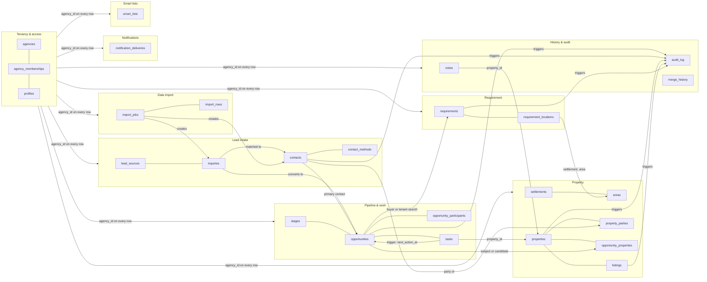

Every table except `agencies`, `profiles` and the global reference table `settlements` carries
`agency_id` and is isolated by RLS
(`current_agency_id()`). `profiles` is user-level, visible to self and colleagues
(`shares_agency_with()`).

---

## 2. Entity diagrams by area

Only keys and columns that carry business meaning are shown. `id`, `created_at`,
`updated_at` exist on every table (except: `opportunity_participants`, `merge_history`,
`import_rows`, `requirement_locations` have no `updated_at`; `audit_log` uses `performed_at`).

### 2.1 Tenancy & access

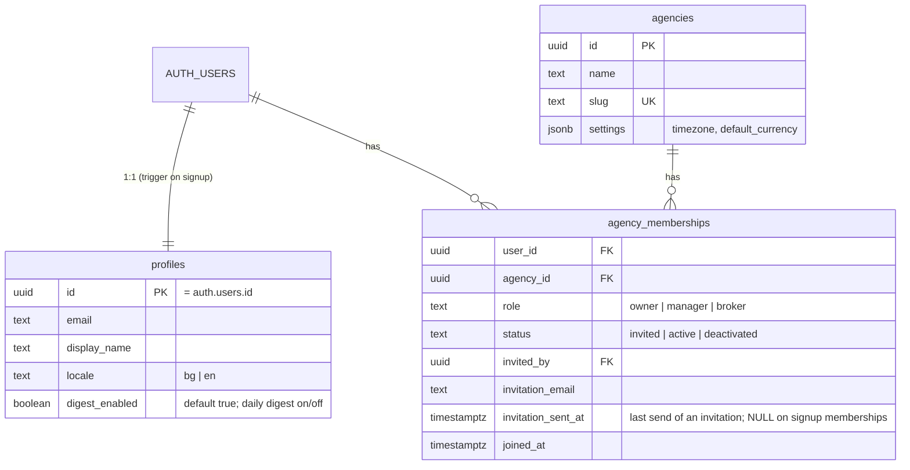

### 2.2 Lead intake

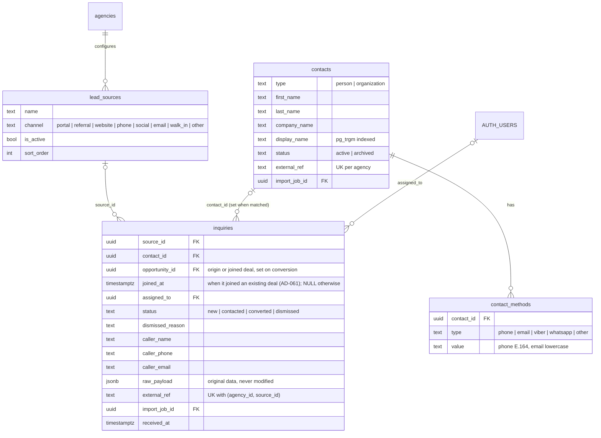

### 2.3 Pipeline & work

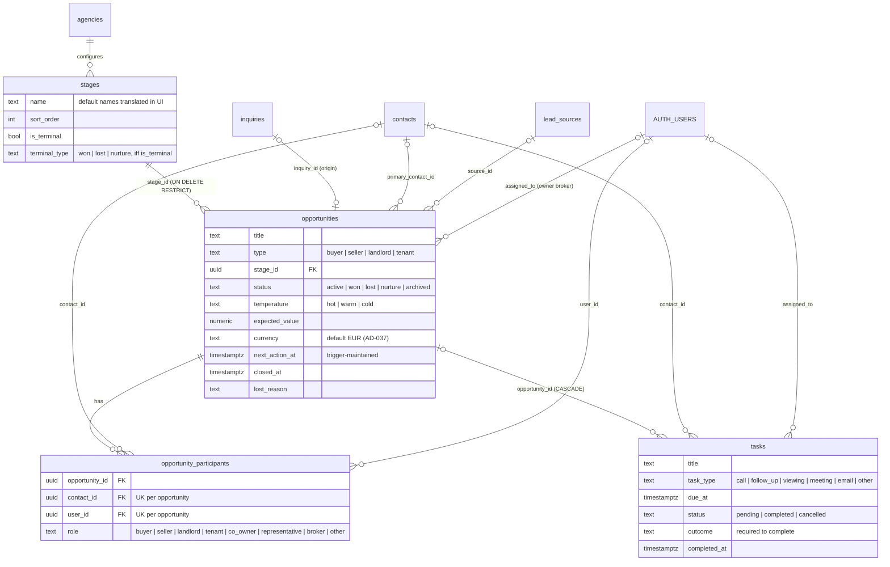

### 2.4 History & audit

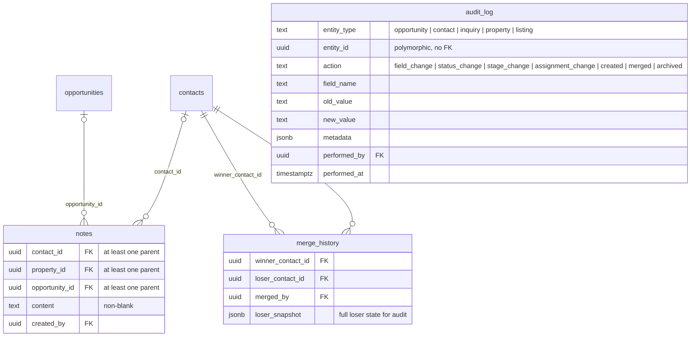

The **timeline** (`src/domain/timeline`) is not a table. It reads `notes`, `tasks`,
`audit_log` and `inquiries` in parallel and merges them in memory into the
`TimelineEntry` union. A deal's timeline shows the inquiry it started from and the ones that joined
it (`opportunity_id` = the deal); a joined inquiry is marked `joined` and dated by its `joined_at`
(AD-061). The contact timeline is unchanged.
The property timeline reads the property's own `property` rows, its `listing` rows (by
`metadata.property_id`), the `opportunity` rows with `field_name = 'property_link'` for it, and
tasks with its `property_id`; a link change is one row that both timelines show (AD-057).
Listing and link rows are the only audit rows with `metadata.property_id`; `idx_audit_property`
(partial, on `agency_id, metadata->>'property_id', performed_at`) finds them.
A requirement save is one `opportunity` row with `action = 'field_change'` and
`field_name = 'requirement'` (AD-059), written by `trg_audit_requirement_changes`:
`metadata = { event: created | changed | removed, changes: [{ field, from, to }] }`. `changes`
holds only what changed (a created entry: what was set, `from` its empty value; a removed
entry: what was there, `to` its empty value). The `locations` change lists
`{ settlement_id, settlement_bg, settlement_en, area_id, area }`, so an entry keeps the names
it had. A save that changes nothing, and the cascade of a deleted opportunity, write no row.
The opportunity and contact timelines read these rows with the other opportunity rows.
`describeAudit` (`audit-event.ts`) turns a row into the event both timelines render; a
requirement row becomes the `requirement` kind, its changes shown old → new with the location
names it was saved with, in the reader's language.

### 2.5 Data import

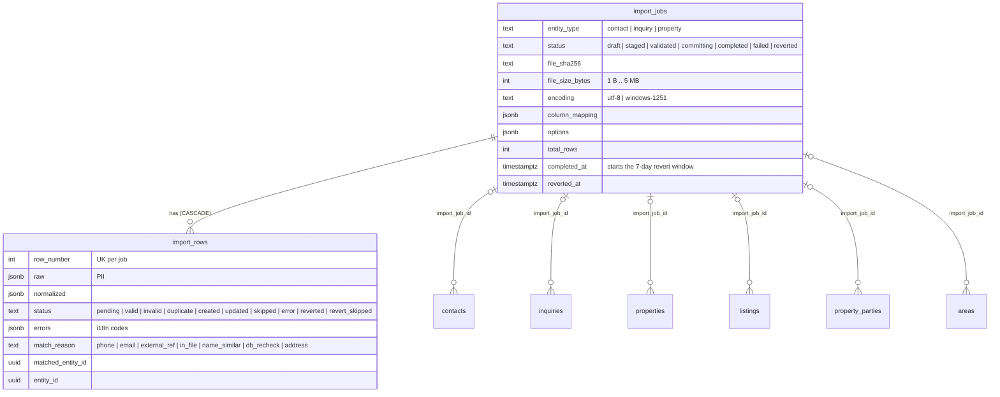

A property import (AD-064) stamps `import_job_id` on every record a row creates: the
property, its listings, its owner party, the owner contact when it is new, and new areas
(all `ON DELETE SET NULL`, partially indexed). `properties.address_key` is a stored column
generated by `property_address_key(address)`: lowercase, punctuation and the words
`ул`/`улица`/`бул`/`булевард`/`ж.к.` removed, then all whitespace; NULL for a blank address.
It is the only copy of the address-duplicate rule (index `(agency_id, settlement_id,
address_key)`): validation asks `import_property_address_matches(items)` (`SECURITY INVOKER`,
filtered by `current_agency_id()`) for each row's key and the existing property with it.
Validation classifies a property row, in file order: owner phone must parse and a new owner
needs a name (else `invalid`); an `external_ref` an existing property or earlier row has →
`skipped` / `external_ref`; the same settlement and key as an existing property →
`duplicate` / `address`, as an earlier row → `duplicate` / `in_file`. The owner is matched by
phone, then email, in the agency; a name-only owner is always a new contact.

`import_commit_properties(job, limit)` writes each row in its own savepoint (AD-050): it
re-checks `external_ref` (always skips) and the address (skips unless the strategy is
`create`) as `db_recheck`; creates a kept new area (`options.create_areas`, absent = all) with
`ON CONFLICT` so rows share it; re-matches a new owner by phone, then email, before creating
the contact, so rows share it; then inserts the property (code in file order), its listings
(`closed_at` = now for closed or withdrawn) and an `owner` party, all with `import_job_id`.
Under `create`, `duplicate` rows are committed too; under `skip` they stay `duplicate`. The `created` audit rows of a property and a listing carry `import_job_id`
in `metadata` when the record came from an import.

### 2.6 Notifications

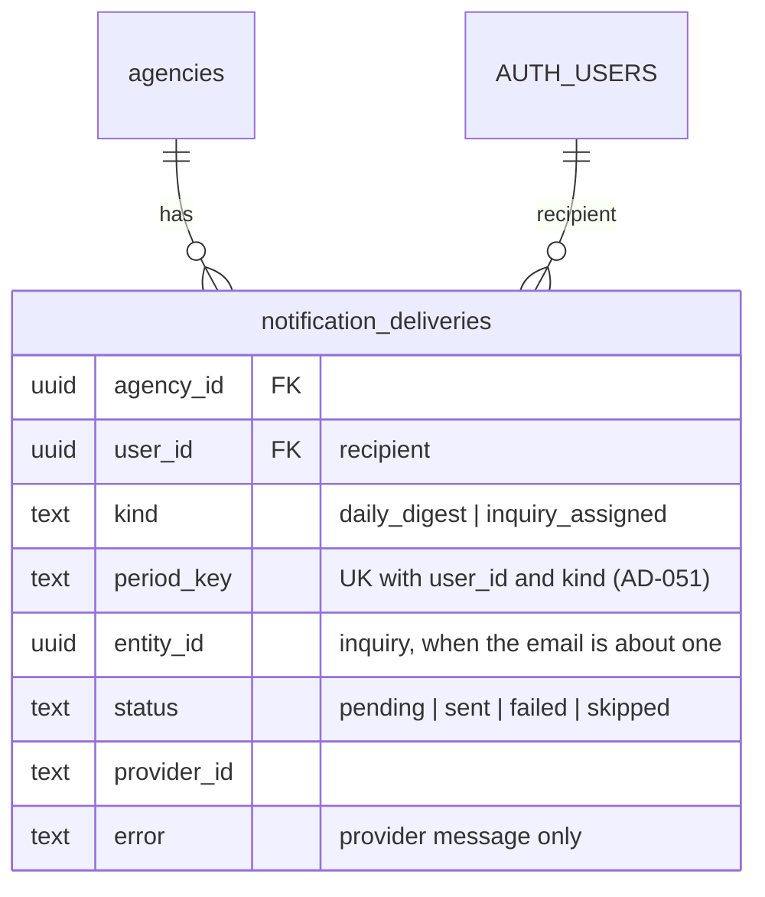

Written only by the service role (the digest route and `after()` work); a member reads their
own rows, an owner or manager the agency's. `pending` is a claim in flight; `sent` and
`pending` block a repeat, `failed` and `skipped` (an empty digest) can be claimed again.

### 2.7 Property

`spec/properties.md`, AD-056, AD-057. A property is the physical asset; what is offered
(sale or rent, price) is a listing; who owns or represents it are parties; how it relates to
a deal is an opportunity link. There is no owner or price column on `properties`.

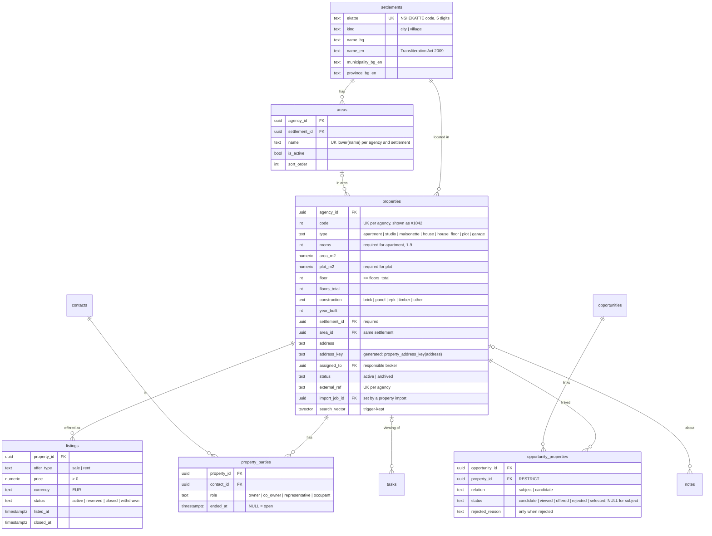

`settlements` is global (no `agency_id`), generated from the NSI EKATTE export by
`scripts/ekatte/build-settlements.ts` into one data migration: towns and villages only,
no monasteries. The picker searches by prefix on `lower(name_bg)` / `lower(name_en)`.

⌘K finds properties through `properties.search_vector` (AD-026): the code, then the address
and area name, then the settlement in both languages. `trg_property_search_vector` keeps it on
insert and on a change of code, address, settlement or area; renaming an area rewrites the
vectors of its properties (`trg_areas_search_vector_cascade`), which also moves their
`updated_at`. The 'simple' parser drops a leading `#`, so `#1042`
finds 1042; `toPrefixQuery` escapes quotes and backslashes so any input parses.

Every reference between agency rows in this area is a composite `(agency_id, x_id)` foreign
key (AD-057), including `tasks.property_id` (`ON DELETE SET NULL (property_id)`) and
`notes.property_id` (`CASCADE`). A property's open listings are those `active` or `reserved`.
A linked property and a used area can't be deleted (`RESTRICT`); they are archived or
deactivated. Ending a party keeps the row as ownership history, and a contact with parties,
ended or open, can't be deleted (`NO ACTION`, so an agency delete still cascades).

### 2.8 Requirement

`spec/requirements.md`, AD-059. What a buyer or tenant is looking for, on the opportunity
itself. The offer type is not stored: a buyer's budget is a price, a tenant's a monthly rent.

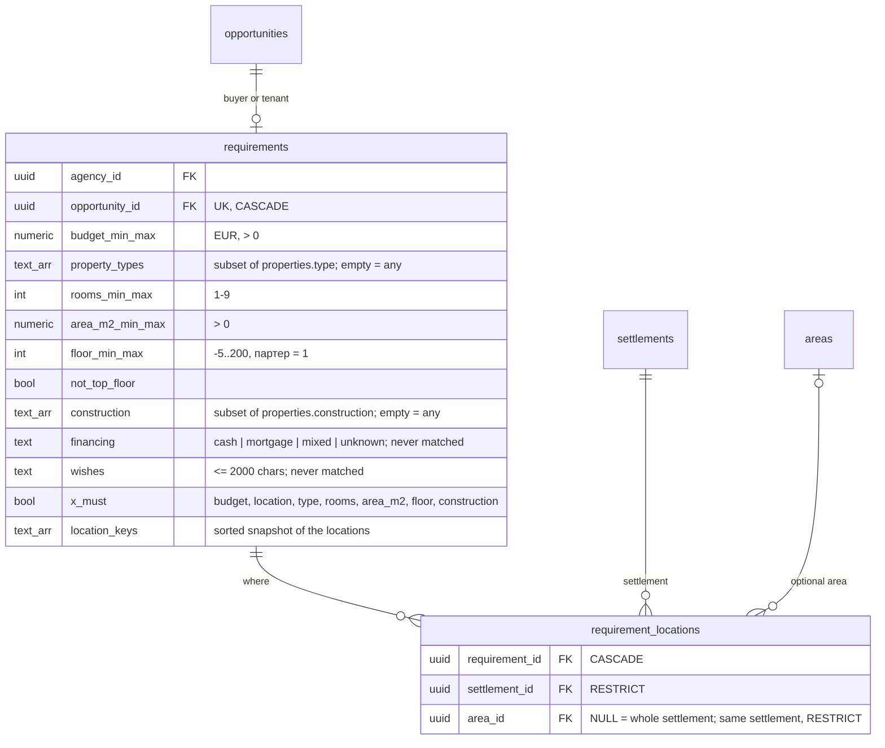

Members read both tables and write neither: `INSERT`, `UPDATE` and `DELETE` are revoked, so the
only writers are the AD-059 RPCs. `save_requirement(opportunity, fields, locations)` replaces the
whole requirement (a missing field is empty) and its locations in one transaction;
`remove_requirement(opportunity)` deletes it, its locations cascading. Both are `SECURITY
DEFINER`, lock the opportunity, and refuse with `requirements.errors.*` keys: `notFound` (not in
the caller's agency, or nothing to remove), `wrongOpportunityType`, `readOnly` (won, lost,
archived), `invalid` (a `CHECK`), `invalidLocation` (a foreign key), `locationCovered` (a whole
settlement with one of its areas) and `inactiveArea` (a deactivated area not already saved).
It stores `property_types` and `construction` in the list's order, so re-ordering them is no
change. `location_keys`
holds `settlement_id` or `settlement_id:area_id` for each location row, sorted, written with
them; it is what the `CHECK`s and the audit see of the locations. A min and max pair is shown
as one line above (`budget_min`, `budget_max`, and so on); `x_must` stands for the seven
must-have flags. `matching` treats a must-have as a filter and the rest as score.

### 2.9 Matching

`spec/matching.md`, AD-060. No table: a match is computed when it is read from `requirements`
(with `location_keys`), `properties`, `listings` and `opportunity_properties`.

- **`match_evaluate(requirement, property, listing) → jsonb { score, listed, criteria }`**:
  `IMMUTABLE`, reads only its arguments, the only place the rules live. `criteria` has one
  `{ criterion, result, must }` per criterion the requirement sets, in reading order (type,
  rooms, area_m2, location, budget, floor, construction); `result` is `match | close | miss |
  unknown | n/a`. `listed` = no must-have is close or miss, at least one applicable criterion,
  score above 0. Financing and wishes are never matched.
- **`match_properties(opportunity, include_linked, limit, offset)`** and
  **`match_opportunities(property, include_linked, limit, offset)`**: `SECURITY INVOKER` plus an
  explicit `current_agency_id()` filter. Open (`active`/`reserved`) listings of an active
  property against requirements of `active`/`nurture` buyer (sale) and tenant (rent) deals.
  Ordered reserved last, then score, then newest listing (deal side) or most recently updated
  deal (property side), then id. Each row carries `link_status`, `total_count` (rows in this
  view) and `unlinked_count` (new matches); a page past the end returns no rows. `limit` is
  capped at 100. Measured at 2,000 properties + 2,000 requirements (`scripts/matching/scale.sql`):
  p95 about 150 ms each.
- **`opportunity_properties.source`** (`manual | match | viewing`, default `manual`), set on
  insert only; a completed viewing that creates a link writes `viewing`. The app sets `manual`
  or `match` (`addCandidateSchema` refuses `viewing`).
- **App side** (`src/domain/matching/`): `MatchingService` pages the two functions (a page past
  the end returns page 1) and adds names; `toChips` maps `criteria` to chips without computing a
  result. Writes reuse `OpportunityPropertyService`: **Add as candidate / Add to this deal**
  creates a `candidate` link with `source = match`; **Not suitable** (`rejectFromMatch`) creates a
  `rejected` link with the optional reason and `source = match`, so the property leaves the new
  matches. Links with `source = match` show "From matches" on both pages. Screens: the deal's
  "Подходящи имоти" section, and the property's "Подходящи купувачи / наематели" section (one
  section; a property listed for sale and rent shows both kinds of deal with their type).

### 2.10 Smart lists

`spec/smart-lists.md`, AD-062, AD-063. **Built** (module `smart-lists`, Done 2026-11-08): the
table, the three list functions, last touch, the overview (`/lists`), the list page
(`/lists/[id]`), Work through, saved lists and sharing.

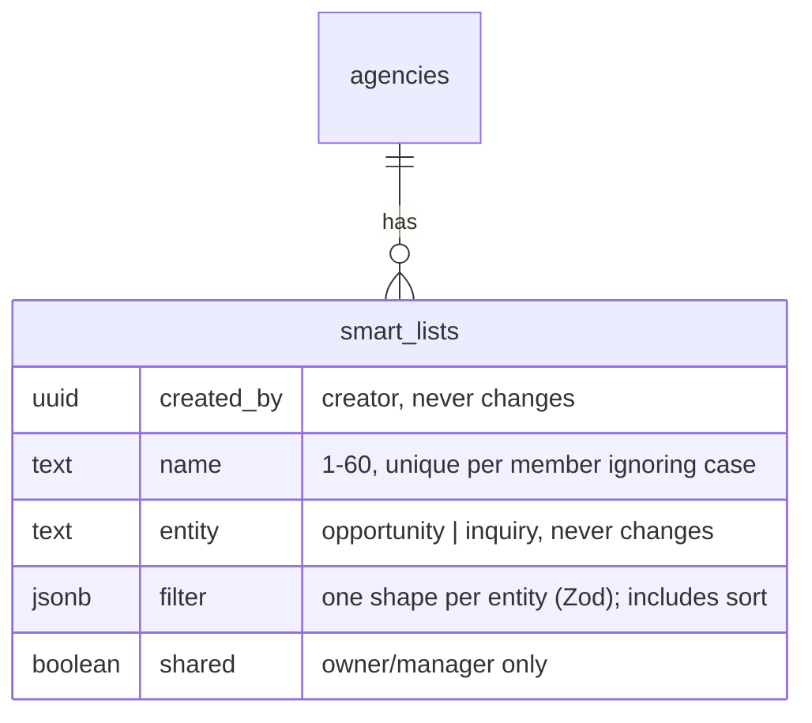

- **`smart_lists` holds custom lists only.** The nine built-in lists are code
  (`src/domain/smart-lists/built-in.ts`), not rows. Not audited.
- **Access:** a personal list is seen and changed by its creator only (a manager can't); only an
  owner or manager can insert or update to `shared = true`; a shared list is seen by the agency
  and renamed, edited or deleted by owners and managers; **only the creator can unshare** (the
  UPDATE policy's `WITH CHECK`: `shared OR created_by = auth.uid()`). `agency_id`, `created_by` and
  `entity` never change. At most 50 lists per member (`smartLists.errors.limit`), of which at most
  5 opportunity lists with `has_new_matches` (`smartLists.errors.matchListLimit`). A member's lists
  go with their auth user (`ON DELETE CASCADE`), shared ones included; deactivating a membership
  keeps them.
- **Last touch** (view `deal_last_touch`, `security_invoker`; `opportunity_last_touch(opportunities)`
  reads it; not stored): the latest completed task's `completed_at` or note's `created_at` on the
  deal, else its `created_at`. Never `updated_at` (edits and merges move it); a cancelled task
  isn't a touch. A view because the list needs it for hundreds of deals: the function, which
  can't be inlined, cost 63 ms for 150 deals against 6.7 ms for the same query inline.
- **`smart_list_opportunities(filter, limit, offset, after)`**: `SECURITY INVOKER` plus an
  explicit `current_agency_id()` filter; the only place a deal list is evaluated. Filter keys
  `status[]` (default `active`), `type[]`, `stage_id[]`, `temperature[]`, `source_id[]`,
  `assigned_to` (`me` = `auth.uid()` | `unassigned` | user id), `next_action` (`none | overdue |
  today | upcoming`; `overdue`/`today` place a deal by `next_action_at`, its earliest pending
  task, so a deal is in one of the two at most), `no_touch_days` (last touch at least N×24 h ago;
  a whole number ≥ 1, any other value matches nothing), `has_new_matches`,
  `search` (title, `%` and `_` literal), `sort` (`created_desc` | `last_touch_asc` |
  `next_action_asc`; ties by `id`). Day windows come from `agencies.settings->>'timezone'` (default `Europe/Sofia`) and
  match `getTodayWindows`: overdue before now, today from now to the next agency midnight,
  upcoming from that midnight to midnight + 4 calendar days. A page returns `last_touch`,
  `total_count` (the whole list, before paging and before `p_after`) and `sort_key`
  (`[position, id]`, both exact below 2^53); passing a row's key as `p_after` returns the rows
  strictly after it, even once that deal has left the list. `limit` is capped at 100. The clock is
  a parameter of `smart_list_opportunities_at` (tests fix it); the public function passes `now()`.
- **New matches** (view `private.deal_match_rows`, `security_invoker`; in `private` so the API
  doesn't expose it, `authenticated` has USAGE and SELECT for the invoker functions): the one join of "which open
  listings of the right offer type fit this deal", extracted from `match_properties`, which now
  reads it, so `match_properties.unlinked_count` and the list's `new_matches` are the same rule.
  A match is new when the property has no link to the deal in any status (`op.is_new`). A view,
  not a function, because only a view is inlined, so "has a new match" as a per-deal
  `LATERAL … LIMIT 1` stops at the first match (a SQL function with the required `search_path`
  always computes every row). Before `match_evaluate` runs, a pre-filter drops pairs that fail a
  must-have type, budget or location; these are necessary conditions on the same columns, and
  `092-smart-list-new-matches.sql` compares the result with a count made from `match_evaluate`
  alone. `smart_list_opportunities` takes `has_new_matches` (true: at least one new match) and
  returns `new_matches` (the exact count) for the rows of the page, otherwise NULL; there is no sort by
  count (founder, Checkpoint 1: counting every deal took 57 s at 2,000 deals). Measured at 2,000
  deals (`scripts/smart-lists/scale.sql`, one broker owns all): `has_new_matches` over every deal
  0.9 s; a page of 20 of the new-matches list 1.3 s (the total over every deal plus 20 counts); on
  "Mine" for a broker with about 70 deals roughly 30 times less.
- **`smart_list_inquiries(filter, limit, offset, after)`**: the same shape for inquiries
  (`SECURITY INVOKER`, explicit agency filter, `total_count`, `sort_key`, `limit` capped at
  100). Filter keys `status[]` (absent = every status, as the inquiry list shows today),
  `assigned_to` (`me | unassigned | user id`), `source_id[]`, `search` (caller name, phone,
  email or subject; `%` and `_` literal), `sort` (`received_desc` default, ties by `id`
  descending | `received_asc`).
- **App side** (`src/domain/smart-lists/`): `built-in.ts` is the only definition of the nine
  built-in lists (filters, scope, i18n key); `SmartListService` decides which lists a viewer sees
  and on which scope (brokers always Mine; the two unassigned lists are owner/manager only) and
  asks for every count of the overview in one `smart_list_counts` call per 100 lists. The
  opportunity list page reads through `smart_list_opportunities` too, so a list and its saved
  copy can't disagree.
- **Saved lists come from the entity list's URL** (AD-063): "Save as list" and "Update list" send
  the page's URL params and the server maps them (`url-filter.ts`, through the deal list's own
  `toListFilter`) by the list's own `entity`. Deal lists store the page's filters, inquiry lists
  status and search, both newest first. A filter the page can't show (`me`, `unassigned`, several
  values, another sort, a stale shape) makes "Edit filters" warn before Update replaces it.
  A stored filter that no longer parses shows "edit this list" instead of rows (rule 5).
- **Work through** keeps the queue in the URL (`/opportunities/[id]?list=…&pos=…&key=…`); each
  step is a GET to `/lists/[id]/step` that re-runs the list and redirects to the next deal or to
  "List done" (AD-062).
- **`smart_list_counts(lists)`**: `[{ key, entity, filter }]` in, `(key, count)` out in one call.
  Each count is the list function's `total_count` capped at 1000 ("999+" in the UI), so a count
  can never differ from its list. The filter's `sort` is dropped first: a count never needs it. Bad input raises i18n keys (`smartLists.errors.invalidLists`,
  `invalidEntity`, `tooManyLists` for more than 100 lists), never SQL text.

---

## 3. Lifecycles

Statuses are enforced as `CHECK` value lists. **Transitions** are enforced only where
the "Enforced by" note says so; everything else is convention in services.

### 3.1 Inquiry

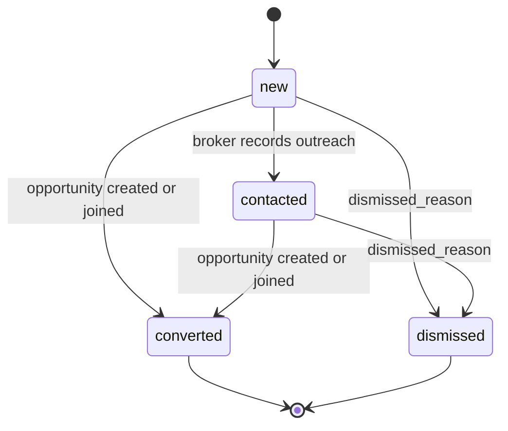

Enforced by: `InquiryService` checks `INQUIRY_STATUS_TRANSITIONS`
(`src/domain/inquiries/validation.ts`); `converted` and `dismissed` are final. The database
checks the value list; the RPC `convert_inquiry` also refuses to convert a final inquiry, under a
row lock, so two simultaneous conversions can't both succeed.

A join (AD-061) also ends in `converted`: `inquiries.opportunity_id` is the joined deal and
`opportunities.inquiry_id` stays the origin only, so an inquiry is "joined" when the two differ. `inquiries.joined_at` records when (not
`updated_at`, which a contact merge moves).

### 3.2 Opportunity: status and stage

An opportunity has two independent axes: `stage_id` (position in the agency's pipeline)
and `status` (lifecycle).

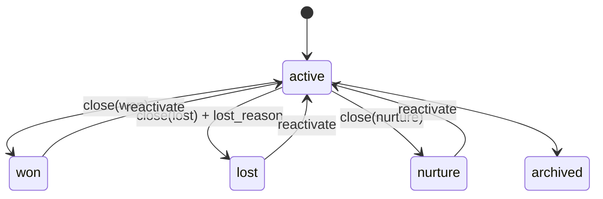

- `close()` sets `status` and `closed_at` (and `lost_reason` for lost);
  `reactivate()` sets `active` and clears both.
- Default stages (seeded per agency, BG or EN by signup locale): New → Attempting Contact
  → Qualified → Active → Viewing → Offer → Negotiation → Won | Lost | Nurture (terminal).
- An agency must keep at least one `won` and one `lost` terminal stage
  (`StageService`). A stage used by opportunities can't be deleted (service plus FK `RESTRICT`).
- See [Known gaps](#6-known-gaps): stage and status are not synchronised.

### 3.3 Task

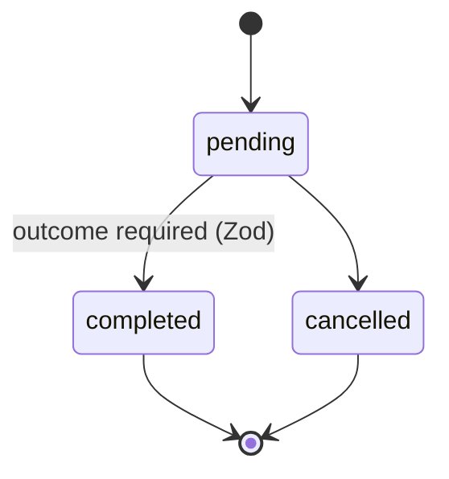

`completeWithNext` optionally creates the next task (inherits opportunity and assignee)
and optionally moves the opportunity's stage. Both are optional (AD-014 soft
enforcement); the UI prompts for them. Every insert, delete, or change to `status` or
`due_at` recomputes `opportunities.next_action_at` = earliest pending `due_at` (trigger).

Only a `pending` task can be edited, rescheduled, cancelled or completed; `completed` and
`cancelled` are final (`TaskService`, `DomainError('errors.task_not_pending')`, plus a
`status = 'pending'` filter on the write, which raises the same error when someone else
changed the task first; AD-046). Cancelling keeps the optional reason in
`outcome`. Reschedule presets (+1 h, tomorrow 09:00, +2 days, next Monday 09:00) and every
`datetime-local` due date are read in the agency's timezone (presets in
`src/domain/tasks/reschedule.ts`, `parseAgencyLocal` in `src/lib/time/agency-day.ts`).

### 3.4 Membership and invitation

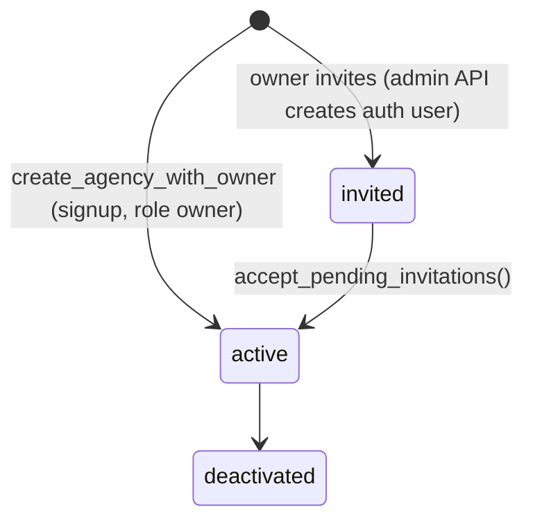

`invitation_sent_at` is set on invite and on each resend. `claim_invitation_resend` (SECURITY
DEFINER) lets an owner resend any pending invitation and a manager a broker's, at most once per 5
minutes, and the service sends the email only after the claim (AD-061).

A user can have at most one `active` membership (partial unique index).
`user_id` and `agency_id` of a membership can never change (trigger).

### 3.5 Import job

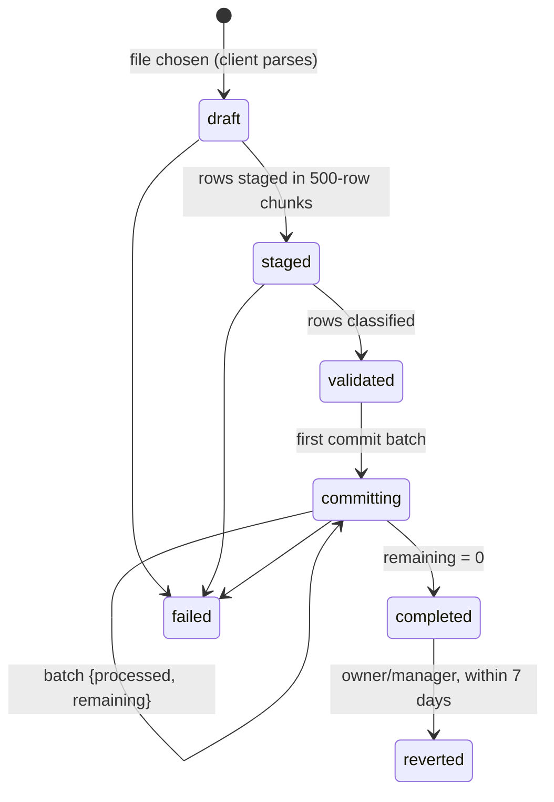

Revert deletes only created records nobody has worked on since (AD-036). A contact is kept if
it was edited or gained a note, task, opportunity, participant, inquiry or merge; the note its
own import row brought in doesn't count unless it was edited. An inquiry is kept if it was
edited or converted. Rows that created a record become `reverted` or `revert_skipped`; rows
that created nothing keep their status.

A duplicate found only at commit (`match_reason = 'db_recheck'`) is `skipped`, or created
under the `create` strategy. The "update existing" strategy isn't built and isn't offered;
a job that still has it stored skips.

### 3.6 Property and listing

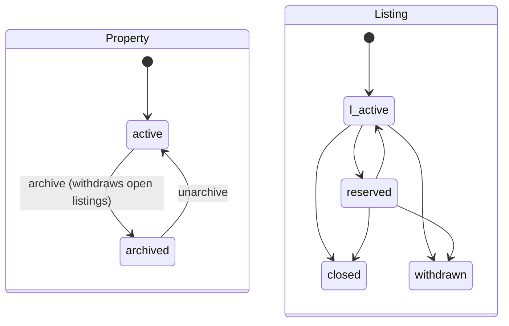

`closed` and `withdrawn` are final and read-only (rule 4, trigger `guard_listing_update`, which
also sets `closed_at`); reopening means a new listing, so the price history stays in the audit
log. Unarchiving a property doesn't reopen its withdrawn listings. An archived property gets no
new listing, link or viewing task (rule 8).

### 3.7 Opportunity–property link

A `subject` link has no status. A `candidate` link's status (`candidate | viewed | offered |
rejected | selected`) can move to any other value, because brokers correct mistakes (rule 6).
The one automatic move is rule 7: completing a `viewing` task with an opportunity and a
property sets `candidate → viewed`, or creates the link as `viewed` on a buyer or tenant deal
when it was missing and the property is active. It never touches `offered`, `rejected`,
`selected` or `subject`. Every change, including adding and removing a link, is one
`opportunity` audit row with `field_name = 'property_link'` and `metadata.property_id`, except
when the whole agency is deleted (its audit log goes with it). A link can't move to another
property or deal (L17).

---

## 4. Derived views: Today and Exceptions

Not stored. Today is assembled in `src/app/(dashboard)/today/today-data.ts` from
`src/domain/tasks` and `src/domain/inquiries`; Exceptions in `src/domain/exceptions`. Both use
agency-local day boundaries (`src/lib/time/agency-day.ts`).

**Today** (`/today`): "my" work for everyone by default. Owners and managers can switch to
the whole agency with `?scope=agency`, which drops the "mine" filter (AD-044). Brokers always
see their own.

| Section | Definition |
|---|---|
| New inquiries | inquiries `status = 'new'` assigned to me |
| Overdue | my tasks `pending` with `due_at < now` |
| Due today | my tasks `pending` with `now ≤ due_at <` agency midnight |
| Upcoming | my tasks `pending` from tomorrow 00:00 to the end of day +3 (agency tz) |
| At risk | my opportunities `active` with `next_action_at` null |

The ranges are half-open and contiguous (`getTodayWindows`), so a task is in one section only.

**Exceptions** (`/exceptions`, owner/manager only):

| Section | Definition |
|---|---|
| Unassigned inquiries | `status = 'new'` and `assigned_to` null |
| Overdue tasks by broker | count of `pending` tasks with `due_at < now`, most overdue first |
| At risk | `active` opportunities with `next_action_at` null, updated within 7 days |
| Stale | same, but not updated for 7+ days |
| Workload | active opportunities and pending tasks per broker |

**Daily digest** (`src/domain/notifications`): the recipient's own Overdue, Due today and New
inquiries, as on Today. Owners and managers also get two agency counts, as on Exceptions:
unassigned inquiries, and overdue tasks with an assignee. The digest reads past PostgREST's
1,000-row cap and `getDashboardData` doesn't, so above that size the digest's count is the right
one (AD-052).

**Assignment email** (`notifyInquiryAssigned`): when a change really moves an inquiry to someone
other than the person acting, the new assignee gets an email after the response, whatever their
digest setting. It holds the caller's name and a link, and goes only to an active member of the
agency. A failure is logged and recorded as `failed`, and never fails the action. Nothing retries
it, but a `new` inquiry still appears in the next digest. On conversion the opportunity's owner
gets it, linking to the opportunity, when they differ from the inquiry's assignee and the person
acting. An inquiry import sends each assignee other than the importer one summary with their
count of `new` inquiries, the same count as the import preview, once the last batch is in.

---

## 5. Invariants

The "Enforced by" column tells you which layer to change and test.

| # | Rule | Enforced by |
|---|---|---|
| T1 | Every tenant row has `agency_id`; users see only their agency | RLS `ENABLE` and `FORCE` + `010-rls-catalog.sql` |
| T2 | Hard delete of contacts, inquiries, opportunities, tasks, stages, lead sources, areas, properties, listings and property parties only by owner/manager; contact methods, participants, opportunity–property links and notes by any member | RLS `current_user_role()` on the DELETE policies |
| T3 | One active membership per user | partial unique index `uq_one_active_membership_per_user` |
| T4 | Membership `user_id`/`agency_id` immutable | trigger `trg_membership_identity` |
| T5 | Agency + owner membership + default seeds created atomically | RPC `create_agency_with_owner` |
| T6 | Creating or editing stages, lead sources and areas, and merging contacts, is owner/manager only (AD-045) | RLS `current_user_role()` on `stages`, `lead_sources`, `areas`, `merge_history` + `requireRole()` in the actions + role check in RPC `merge_contacts` |
| T7 | A pending invitation is resent only by whoever may send it (owner any, manager brokers), at most once per 5 minutes; the claim and the cooldown are one conditional `UPDATE` (AD-061) | RPC `claim_invitation_resend` + `083-invitation-resend.sql` |
| C1 | Person needs a name; organization needs `company_name` | `CHECK` on `contacts` |
| C2 | Phones E.164 (any country, BG default region, AD-041), emails lowercase | `normalizePhone()` / Zod on contact methods and inquiry callers; `callerContactMethods()` at conversion |
| C3 | Duplicate check (phone, email, trigram name) before creating a contact, including at inquiry conversion | `duplicate-detection.ts` (service) |
| C4 | Merge moves everything to the winner, archives the loser and snapshots it, all or nothing (AD-050) | RPC `merge_contacts` (property parties since `properties`: an overlapping open party of the loser is ended) + `070-atomic-convert-and-merge.sql`, `072-properties.sql` |
| C5 | `external_ref` unique per agency | unique index `uq_contacts_agency_external_ref` |
| I1 | `raw_payload` is never modified | convention (not in update schema) |
| I2 | Inquiry idempotent on `(agency_id, source_id, external_ref)` | unique index `uq_inquiries_source_external_ref` |
| I3 | Inquiry status follows `new → contacted → converted / dismissed`; a converted or dismissed inquiry can't be edited or reassigned | `InquiryService` + `INQUIRY_STATUS_TRANSITIONS` |
| I4 | An inquiry's new assignee is an active member of its agency; any member may assign (AD-001, AD-049) | `assertAssignable()` in `InquiryService` create, update and convert (a CSV import resolves assignees separately) |
| I5 | Editing an inquiry never changes `raw_payload` or `received_at` | not in `editInquirySchema` or `updateInquirySchema` |
| I6 | Conversion creates the contact, its methods and the opportunity and closes the inquiry, all or nothing (AD-050) | RPC `convert_inquiry` + `070-atomic-convert-and-merge.sql` |
| I7 | A join closes the inquiry into an open (`active`/`nurture`) deal that has the contact, reactivates a `nurture` deal and may create one `call` task, all or nothing (AD-061) | RPC `join_inquiry` + `082-conversion-join.sql` |
| O1 | Opportunity always has a stage | `NOT NULL` + FK `RESTRICT` |
| O2 | Lost requires `lost_reason` | Zod `closeOpportunitySchema` |
| O3 | `next_action_at` = earliest pending task due date | trigger `sync_opportunity_next_action` |
| O4 | `active` with no `next_action_at` ⇒ at risk | derived view (section 4) |
| S1 | `terminal_type` set iff `is_terminal` | `CHECK terminal_type_consistency` |
| S2 | At least one won and one lost stage per agency | `StageService` |
| K1 | Completing a task requires an outcome | Zod `completeWithNext` in `taskSchemas()` |
| K2 | Next task or stage change on completion | UI prompt only (AD-014, soft) |
| K3 | Only a pending task can be edited, rescheduled, cancelled or completed (AD-046) | `TaskService` + `status = 'pending'` filter on the write |
| P1 | Participant has a contact or a user, each at most once per opportunity | `CHECK` + unique constraints |
| N1 | A note has a contact, opportunity or property parent in its own agency, and non-blank content | `CHECK` on `notes`, composite FK; `createNoteSchema` (trimmed) and `NotesService.createNote` (property in the agency) give the friendly errors |
| R1 | A new profile's name falls back from `display_name` to `full_name`, first + last name, then the email prefix | trigger `handle_new_user` |
| A1 | `audit_log` is append-only, written by triggers | no insert/update/delete policy for members; SECURITY DEFINER triggers on opportunities, contacts (imported contacts via `audit_imported_contact_created`), properties, listings, opportunity–property links and requirements |
| E1 | One delivery per `(user_id, kind, period_key)`: a send is claimed by inserting a `pending` row first (AD-051) | unique constraint `uq_notification_deliveries_key` + `071-notification-deliveries.sql` |
| E2 | Clients never write `notification_deliveries`; members read their own rows, owners and managers the agency's | RLS (no write policy, writes revoked) + `071-notification-deliveries.sql` |
| L1 | Settlements are read by every signed-in user and written only by migrations | RLS `FORCE` with a `SELECT` policy only, writes revoked from `authenticated`, all access from `anon` + `072-properties.sql` |
| L2 | A property row points only at its own agency's rows (area, listing, party, link, task, note) | composite `(agency_id, x_id)` foreign keys (AD-057) + `072-properties.sql` |
| L3 | An apartment has 1–9 rooms; a plot has `plot_m2` and no rooms or floor; `floor ≤ floors_total` (rule 3) | `CHECK`s on `properties` |
| L4 | An area belongs to the property's settlement; area names are unique per agency and settlement, ignoring case | composite FK `fk_properties_area`, unique index `uq_areas_agency_settlement_name` |
| L5 | At most one open (`active`/`reserved`) listing per property and offer type; price > 0 in EUR | unique index `uq_listings_open_per_offer_type`, `CHECK`s on `listings` |
| L6 | One open party row per property and contact | unique index `uq_property_parties_open` |
| L7 | A link has a status iff it is a `candidate`, a reason only when `rejected`; one `selected` and one `subject` per opportunity | `CHECK`s + unique indexes on `opportunity_properties` |
| L8 | A linked property can't be deleted, nor an area a property uses | FK `ON DELETE RESTRICT` |
| L9 | A property `code` is the agency's next number from 1001, never reused within the agency and never changed | trigger `assign_property_code` (row lock on `agencies.property_code_seq`) + `073-property-triggers.sql` |
| L10 | `subject` links only on seller/landlord deals, `candidate` only on buyer/tenant; an opportunity's type can't change to one its links don't allow (rule 5) | triggers `check_property_link_relation`, `check_opportunity_type_vs_properties` |
| L11 | A `closed` or `withdrawn` listing is read-only (rule 4) | trigger `guard_listing_update` |
| L12 | Archiving withdraws open listings; an archived property gets no new listing, link or viewing task (rule 8) | triggers `withdraw_listings_on_archive`, `refuse_archived_property` |
| L13 | A completed viewing moves its link `candidate → viewed` or creates it as `viewed`, never backwards (rule 7) | trigger `mark_property_viewed` + `073-property-triggers.sql` |
| L14 | A property with links, open listings or tasks is archived, not deleted (rule 1) | `PropertyService.delete` counts all three first (not atomic: links are also `RESTRICT`, L8, but a task added meanwhile only gets `property_id` set to NULL) + `manage.integration.test.ts` |
| L15 | A property's responsible broker is an active member; the creator by default (rule 2) | `assertAssignable()` in `PropertyService` create and update, like I4 |
| L16 | A task's property is set only on a `viewing` with an opportunity; another task type drops it (rule 7) | `taskSchemas().create` (Zod, also the next task of a completion) + `validation.test.ts`; not a `CHECK`, so other writers aren't held to it |
| L17 | A link and a listing stay on their property: members update only a link's `status` and `rejected_reason`, and a listing's `price` and `status` (AD-058) | column `UPDATE` privileges on `opportunity_properties` and `listings` + `074-property-review-fixes.sql` |
| L18 | A contact who is a property party, now or in the past, keeps its party rows: it can't be deleted, and an import revert keeps it as worked on | FK `fk_property_parties_contact` (`NO ACTION`), RPC `import_revert` + `074-property-review-fixes.sql` |
| Q1 | A requirement exists only on a buyer or tenant opportunity, at most one each; a deal with one can't change to seller or landlord (buyer ↔ tenant keeps it) (rule 1) | trigger `check_requirement_opportunity_type`, unique `uq_requirements_opportunity`, trigger `check_opportunity_type_vs_requirement` + `077-requirements.sql` |
| Q2 | A requirement has a budget bound, a location, a type, a rooms bound or an m² bound; financing and wishes alone don't count (rule 2) | `CHECK requirements_has_criterion` (counts `location_keys`) |
| Q3 | Every min ≤ max; rooms 1–9; budget and m² > 0; floor −5…200; types and construction are subsets of the property lists; wishes ≤ 2,000 chars (rule 3) | `CHECK`s on `requirements` |
| Q4 | A must-have flag is on only when its criterion is set (`not_top_floor` counts for floor) (rule 4) | `CHECK requirements_must_has_criterion` |
| Q5 | A location's area belongs to its settlement and agency; a location is listed once per requirement; a whole settlement isn't listed with one of its areas; a newly added area is active (one deactivated since it was saved stays, rule 6); a used area can't be deleted | composite FK `fk_requirement_locations_area` (`RESTRICT`), `UNIQUE NULLS NOT DISTINCT`, checks in `save_requirement` + `079-requirement-review-fixes.sql` |
| Q6 | Requirements and their locations point only at their own agency's rows; members read their own agency's and write neither directly (rule 10, AD-059) | composite FKs, RLS `SELECT` only, writes revoked + `077-requirements.sql` |
| Q7 | A requirement is written only through `save_requirement` / `remove_requirement`, which check the agency, the deal type and an `active` or `nurture` status; `location_keys` always equals the location rows (rules 1, 7, AD-059) | the two `SECURITY DEFINER` RPCs + `078-requirement-writes.sql` |
| Q8 | One save is one timeline entry with the old and new value of each changed criterion; a save that changes nothing (re-ordered types or construction included) writes none (rule 8, FR-REQ-04) | trigger `audit_requirement_changes`, the no-change `WHERE` and list order in `save_requirement` + `078`, `079` |
| L19 | A link's `source` is `manual`, `match` or `viewing`, set on insert and never updated; the app may send `manual` or `match` (a member could send `match`: it only feeds a measurement) (AD-060) | `CHECK opportunity_properties_source_check`, column `UPDATE` privileges (AD-058), trigger `mark_property_viewed` + `080-matching.sql` |
| S1 | A personal smart list is seen and changed by its creator only, a manager included; only owners and managers can insert or update to `shared = true`; a shared list is changed or deleted by owners and managers only; only the creator can unshare (AD-062) | RLS policies on `smart_lists` (`WITH CHECK` on update: `shared OR created_by = auth.uid()`) + `090-smart-lists.sql`, `095-smart-list-review-fixes.sql`; `requireRole()` in the share actions and `canEditList` / `shareState` in `SmartListService` |
| S2 | A smart list's `agency_id`, `created_by` and `entity` never change; `entity` is `opportunity` or `inquiry`; the name is 1–60 characters and unique per member ignoring case | trigger `smart_lists_immutable`, `CHECK`s, unique index `uq_smart_lists_member_name` + `090-smart-lists.sql` |
| S3 | A member holds at most 50 smart lists, at most 5 of them opportunity lists with `has_new_matches` | triggers `smart_lists_limit` (`smartLists.errors.limit`) and `smart_lists_match_limit` (`smartLists.errors.matchListLimit`) + `090-smart-lists.sql`, `095-smart-list-review-fixes.sql` |
| M1 | Import file ≤ 5 MB, UTF-8 or Windows-1251 | `CHECK` on `import_jobs` |
| M2 | Import revert: owner/manager, `completed` job, within 7 days, and never deletes a record someone has worked on (a property party counts as work, L18) | RPC `import_revert` + `063-import-revert.sql`, `074-property-review-fixes.sql` |
| M3 | An import row's assignee resolves by email, or by a name only one active member has. Anything else makes the row invalid rather than guessing | `resolveAssignee` + `value-resolvers.test.ts` |

---

## 6. Known gaps

Where the built model breaks its own rules. Each is a candidate for a fix or an AD; the
module that fixes it is named where there is one. Remove a row when the fix lands.

1. **Stage and status are independent.** Closing an opportunity does not move it to a
   terminal stage, and moving it to a terminal stage (including via `completeWithNext`)
   does not change `status`. An opportunity can sit in stage "Won" with status `active`.
2. **Inquiries are not audited.** `audit_log.entity_type` allows `'inquiry'`, but no
   trigger exists on `inquiries`.
3. **Opportunity status transitions are unchecked.** `close()` and `reactivate()` don't check
   the current status (inquiries and tasks are checked: I3, K3).
4. **Old inquiry callers the backfill can't read.** New and edited callers are normalized (C2).
   `backfill_inquiry_callers()` converted stored BG mobiles and emails; landlines and other
   formats stored before `trustworthy-loop` stay as typed until edited, though conversion
   still parses them.
5. **BG vocabulary is inconsistent** (see the glossary): the same term has several translations.
6. **"Create property" from a deal is three writes.** `createSubjectProperty` checks the deal
   (seller or landlord, no subject yet) and then creates the property, the owner party and the
   subject link one after another. If a later write fails, the property stays without its owner
   or link, and the broker links it by hand. An RPC would make it one transaction.

---

## 7. Glossary EN / BG

The BG column is the **canonical** term. Use it for new strings. Variants found in
`messages/bg.json` are listed so they can be aligned.

| English | Bulgarian (canonical) | Meaning | Variants in use |
|---|---|---|---|
| Agency | Агенция | Tenant: one brokerage | |
| Owner / Manager / Broker | Собственик / Мениджър / Брокер | Membership roles | |
| Inquiry | Запитване | Inbound lead event | |
| Lead source | Източник | Where inquiries come from | Източници на запитвания, Източници на лийдове |
| Contact | Контакт | Durable person or organization | |
| Contact method | Метод за връзка | Phone, email, Viber... | |
| Opportunity | Сделка | Commercial pursuit (AD-038) | |
| Stage | Етап | Pipeline position | |
| Pipeline | Фуния | Ordered stages | пайплайн (Фуния itself not used yet) |
| Won / Lost | Спечелена / Загубена | Terminal outcomes | Изгубена |
| Nurture | Задържана | On hold for later | Отглеждане, За подхранване |
| Task | Задача | Scheduled follow-up | |
| Outcome | Резултат | What happened on a task | |
| Next action | Следващо действие | Earliest pending task | |
| At risk | В риск | Active, no next action | |
| Overdue | Просрочена | Pending, past due | |
| Stale | Изоставена | At risk and not updated 7+ days | |
| Note | Бележка | Free-text history entry | |
| Merge | Сливане | Combine duplicate contacts | |
| Import | Импортиране | CSV import | Внасяне |
| Revert import | Отмяна на импорта | Undo an import | Възстанови (wrong: means "restore") |
| Exceptions | Изключения | Manager problem dashboard | |
| Temperature | Интерес | Hot, warm or cold | |
| Settlement | Населено място | Town or village from the EKATTE register | |
| Property | Имот | The physical asset | |
| Listing | Обява | A sale or rent offering of a property, with a price | |
| Area | Квартал | Agency-defined district of a settlement | |
| Party | Страна | Contact with a role on a property (owner, co-owner, representative, occupant) | |
| Candidate | Кандидат | Property proposed on a buyer or tenant deal | |
| Subject property | Обект на сделката | The property a seller or landlord deal is about | |
| Requirement | Изисквания | What a buyer or tenant is looking for, on the opportunity (plural, as brokers say it) | |
| Must-have | Задължително | A requirement criterion `matching` treats as a filter | |
| Match (on a deal) | Подходящ имот | A property that fits a buyer's or tenant's requirement | |
| Match (on a property) | Подходящ купувач / наемател | A buyer or tenant deal the property fits | |
| Match score | Съвпадение | Share of the applicable criteria met, shown as "Съвпадение 85%" | |
| Join (an inquiry to a deal) | Присъединяване | Closing an inquiry into the contact's existing open deal instead of creating a new one | |
| Close | Близо | A criterion missed by a small tolerance; half credit | |
| Smart list | Списък (nav: Списъци) | A named filter of deals or inquiries with a live count; built-in or saved (AD-062) | |
| Work through (a list) | Обработи | Open the list's deals one after another with a queue bar | |

---

## 8. How to extend this model

For a new feature:

1. Decide which area it belongs to, or add a new area to the context map.
2. Add or change the table in that area's ER diagram (keys and business columns only).
3. If it has a status: add a lifecycle diagram and note what enforces the transitions.
4. Add every new rule to Invariants with its enforcement layer, preferring DB or Zod over
   convention, and add a test for it.
5. Add new vocabulary to the glossary with one canonical BG term.
6. Record trade-offs in `docs/decisions-log.md` and link the AD number here.
