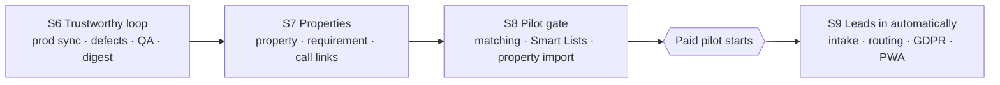

# BrokerCRM Roadmap — Sprint 6 to the Pilot and Beyond

> **Written:** 2026-10-28 (sprint-planning, Sprint 6). **Refresh** at every sprint close.
> **Direction:** AD-039 (full agency system, follow-up discipline as the edge).
> **Evidence:** `docs/research/crm-competitive-gap-analysis.md` §5, `docs/research/brokercrm-feature-inventory.md`.
> **Capacity assumption:** about 20 dev-days per sprint (4 weeks). Only Sprint 6 is planned in detail; later
> sprints are targets. From Sprint 9 on, pilot evidence (`docs/pilot-feedback.md`) sets the order (AD-039 §2).

## 1. Path to the paid pilot

The pilot gate (AD-039 §6 plus the brief's Pilot Acceptance Criteria) is met at the **end of Sprint 8**:

| Gate item | Sprint |
|---|---|
| Core-loop defects fixed (gap §5.0) | 6 |
| Reminders and daily digest | 6 |
| Light property record linked to opportunities (PAC) | 7 |
| Buyer/tenant requirements (PAC) | 7 |
| Inquiry can create **or join** an opportunity (PAC) | 7 |
| Requirement ↔ property matching, broker sees matches (PAC) | 8 |
| Smart Lists (brief *Pilot MVP → Included*) | 8 |
| Onboarding dry run with an anonymised real agency export | 8 |

Pilot recruiting can start during Sprint 7 (AD-039 §6).

## 2. Sprints

### Sprint 6 — "Make the loop trustworthy" (planned)
Bring prod to the Sprint 5 security baseline with real migration history. Fix the nine §5.0 defects. Set up
the cloud QA stack and the first service tests. Ship the daily digest and inquiry-assigned email (Vercel
Cron + Resend). Details: `docs/sprint-6-implementation-plan.md`.

### Sprint 7 — "Properties and the phone loop" (target)
- **Kickoff:** the property ↔ requirement ↔ opportunity design session (AD-039 consequence), following the brief's
  *Future data model direction*: Property ≠ Listing, parties not a single owner column, candidate
  properties per opportunity with status. New AD.
- Light property record and its parties; link properties to opportunities (candidate / viewed / offered /
  rejected / selected). About 7 d.
- Buyer/tenant requirement on an opportunity (budget, areas, types, rooms, m²). About 3 d.
- `tel:`, `viber://`, `wa.me`, `mailto:` links and a post-call prompt ("answered?" → outcome and next action),
  gap §5.1 #2. About 2 d.
- Join an existing opportunity at inquiry conversion (PAC), and resend invitation (FR-TEM-07). About 1.5 d.
- Record `inquiries.contacted_at` now, so speed-to-lead reporting has data from day 1 of the pilot. About 0.5 d.
- QA thread: E2E specs for the property and requirement flows; service tests for each new domain.
- **Founder decisions before Sprint 7:** the portal syndication approach (alo.bg open spec first; an imot.bg sales
  call), and the pricing test (€20 per broker vs flat per agency).

### Sprint 8 — "Pilot gate: matching and Smart Lists" (target)
- Two-way matching: required criteria plus a score, a "matches" panel on requirement and property, and an "already
  offered" state from the opportunity–property link. About 5 d.
- Smart Lists: saved filters with counts, worked through one by one. Covers the brief's list set that the data
  supports (uncontacted inquiries, unassigned, no next action, due, overdue, hot with no recent activity,
  matches not yet offered, by source). Lists for viewings and offers wait for those modules. About 5 d.
- Property CSV import, reusing the import pipeline (AD-034). Agencies arrive with listings in spreadsheets
  or other tools. About 3 d.
- QA thread: **E2E in CI**, plus coverage thresholds on `src/domain/**`. Once both hold for two sprints,
  revisit whether `ship-pr` can replace `babysit-pr` (CLAUDE.md).
- Onboarding dry run, then a pilot-gate review with the founder, then the paid pilot starts.

### Sprint 9 — "Leads in automatically" (target; pilot evidence may reorder it)
- Portal and email lead intake: parse inquiry emails from homes.bg, imot.bg and alo.bg into inquiries with a source
  and `external_ref` (status waiting / duplicate / done), plus a website form endpoint. Gap §5.1 #3–4.
- Lead routing: round robin, on-duty broker, escalation after N minutes, and a basic shared pool. Gap §5.1 #5, §5.2 #17.
- GDPR basics: legal basis per contact, export of one contact, erasure or anonymisation, and the retention purge job
  (BRD deferred). Gap §5.1 #8.
- PWA shell: manifest, install, icons and a mobile search entry. Push notifications follow with AD-042's revisit.
- Hardening carried over: `pg_trgm` → `extensions`.

## 3. Committed modules (AD-039): where each lands

| Module | Target | Notes |
|---|---|---|
| Reminders and daily digest | S6 | Email only (AD-025, AD-042) |
| Light property record | S7 | Full inventory and mandates later |
| Requirements and matching | S7–S8 | Pilot gate |
| Saved lists (Smart Lists) | S8 | |
| Portal/email lead intake, website form | S9 | Email is the practical path; no BG portal has a lead API |
| Routing and lead pool | S9 | |
| GDPR tools | S9 | Before any integration that imports third-party personal data |
| PWA | S9 (shell) → S10+ (push) | |
| Mandates (exclusivity, expiry) | S10+ | Phase 2 |
| Viewings with feedback | S10+ | Pilot uses a task plus a property link |
| Offers and negotiation | S10+ | Phase 2 |
| Portal syndication | S10+ | alo.bg → OLX → imot.bg, subject to agreements |
| Action plans | S10+ | Phase 3 |
| Expanded reports (speed to lead, conversion, source, productivity) | S10+ | Data captured from S7 |

## 4. Quality thread across sprints

| Sprint | Cloud QA | Tests |
|---|---|---|
| 6 | `npm run stack:up`, seeded logins, dockerd in cloud sessions (AD-043) | Service integration tests; E2E smoke (local and cloud) |
| 7 | Seed gains properties and requirements | E2E property flows; service tests per new domain |
| 8 | Volume seed in CI (2,000 contacts) | E2E in CI; coverage thresholds on `src/domain/**` |
| 9 | Mailpit assertions for intake and digest | Contract tests for email parsers (fixtures per portal) |

## 5. Open risks for the roadmap
- Prod drift happens again unless every change goes through `db push` (AD-040).
- The property data model is the biggest design risk. A mistake there costs every later module.
- Portal access (imot.bg pricing, OLX lead API) is unknown (gap §8).
- No pilot evidence yet. Sprints 9+ should be re-ranked once `pilot-feedback.md` has entries.
